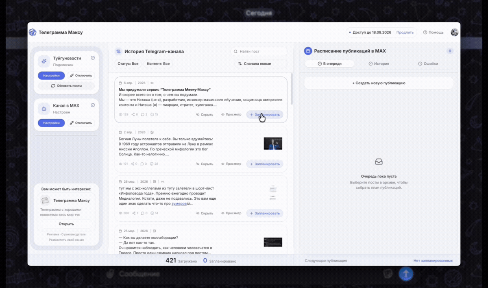
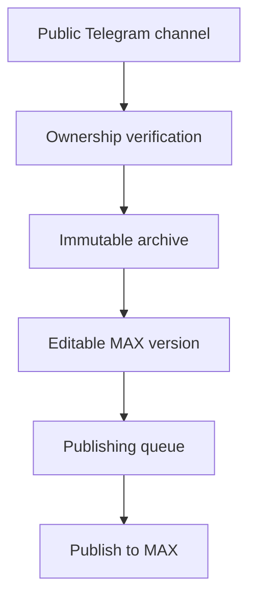
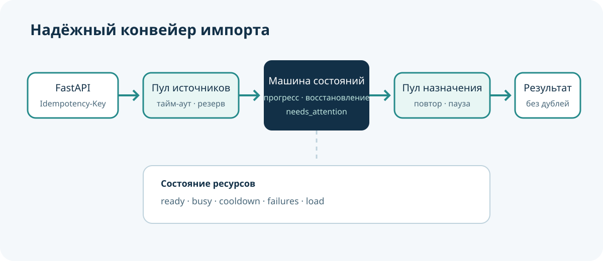

[🇬🇧 English](README.md) | [🇷🇺 Русский](README.ru.md)

# Telegramma Maksu — Content Migration Pipeline

Telegramma Maksu moves content from public Telegram channels to MAX. It verifies channel ownership, collects posts in a library, lets users adapt them for MAX, and queues them for publishing. This repository contains the core that manages long-running imports and resumes them after a failure.

> **Public engineering showcase.** This repository contains a standalone reliability module from a commercial SaaS product. The private production service also includes the web app, authentication, channel verification, media storage, payments, publishing, admin tools, and production infrastructure.

<p align="center">
  <a href="docs/assets/main-page.gif">
    
  </a>
</p>
<p align="center"><sub>Product positioning and visual design. Click to open the full-size image.</sub></p>

## Product

Telegramma Maksu serves creators, experts, and public Telegram channel owners who want to bring their existing content to MAX without recreating posts from scratch.

User flow:

1. Sign in with Yandex ID or VK ID.
2. Enter the URL of a public Telegram channel.
3. Verify ownership using the verification bot or a verification code in the channel.
4. Preview five posts or import the available archive after payment.
5. Add the service bot to the MAX channel and verify its publishing permission.
6. Select an archived post or create a new one.
7. Edit the text and photos.
8. Publish immediately or schedule the post.

The service collects posts after checking channel permissions. Users can import content without uploading an archive file or sharing their Telegram session.

The production system includes a Next.js web app and BFF, a FastAPI backend, PostgreSQL, background workers, an operator-managed pool of Telegram sessions, S3-compatible media storage, a MAX publishing module, T-Bank payments, and infrastructure hosted in Russia.

<p align="center">
  <a href="docs/assets/dashboard-showcase.gif">
    
  </a>
</p>
<p align="center"><sub>Telegram archive, post editor, and MAX publishing schedule in one workspace. Click to enlarge.</sub></p>

## Core product design: archive → MAX version → publishing queue

The Telegram archive and the publishing queue are separate:



The original post remains the source of truth. Its MAX version can have different text, images, and a different publication time. Users can edit the upcoming post while preserving the imported archive.

The system supports text, links, formatting, photos, and photo albums. It combines Telegram media groups into single posts and converts rich text to HTML supported by MAX. Reaction, view, forward, and comment counts help users identify which posts performed best.

## Secure channel setup

- Full imports require verified ownership of the Telegram channel.
- The service separately verifies the MAX bot's publishing permission.
- Each user has a dedicated workspace.
- The service isolates customer data with `workspace_id` and access checks.
- Media keys are scoped to the workspace, and temporary signed URLs provide access to files.
- Internal requests are signed with HMAC.
- T-Bank handles one-time payments without automatic charges.

## Role and scope

My work covered the full product, from the user flow and interface through imports, publishing, payments, and production infrastructure.

Main areas of work:

- Yandex ID and VK ID authentication and workspace access.
- Telegram channel ownership verification.
- Archive import and content normalization.
- Content library, editable versions, and publishing queue.
- Telegram session pool and background worker management.
- MAX bot permission checks and publishing workflow.
- S3-compatible media storage.
- T-Bank payments and access period management.
- Website, legal and product pages, quality assurance, and deployment.

I also built a landing page for the “Sober Carriers on MAX” PR campaign, a standalone website that helped present the project publicly.

<p align="center">
  <a href="docs/assets/pr-project.png">
    
  </a>
</p>
<p align="center"><sub>Landing page for the Sober Carriers on MAX PR campaign.</sub></p>

## Engineering challenge: reliable imports

Long-running imports rely on a limited pool of external resources, run concurrently, and can partially fail. In addition to retrying, the system must account for available capacity, persist progress, and prevent duplicate posts when an item is delivered again.



The public repository contains a standalone reliability module based on the production system:

- A `ResourcePool` with bounded concurrency, operation timeouts, retries, failover, cooldowns, and observable resource states.
- An `ImportJob` state machine with a request fingerprint, SQL checkpoints, a lease, and recovery after partial failure or process restart.
- A `JobStore` port that decouples import orchestration from storage, with a fast `InMemoryJobStore` and a persistent `SqlAlchemyJobStore`.

## What the code demonstrates

- A concurrency limit per external resource.
- Serialized operations on the same channel and concurrent operations across different channels.
- Timeouts for external operations.
- Retries only for transient `TimeoutError` and `ConnectionError` failures. Data errors are returned immediately to the caller.
- Failover between resources.
- Cooldown after repeated failures.
- A resource status summary for the API and operational monitoring.
- Explicit states: `received → fetching → transforming → publishing → completed`.
- A dedicated `needs_attention` state for operator handoff.
- A checkpoint after each state transition and confirmed publication.
- A verifiable `RecoveryPlan` that explains where processing resumes and rejects inconsistent stored state.
- Source ID uniqueness checks before any posts are published.
- A SQL lease that prevents two worker instances from processing the same job concurrently.
- A stable idempotency token at the destination boundary and a test of the crash window during redelivery.
- SQLAlchemy persistence and recovery.
- A containerized FastAPI and PostgreSQL API using asyncpg, with lifecycle initialization and separate liveness and readiness checks.
- A reproducible Docker build with pinned runtime dependencies and a pinned base image digest, plus a Compose environment that waits for PostgreSQL readiness.
- Concurrency tests in pytest.

## Design decisions

### The pool manages resource capacity

A session, account, or connection is represented as a generic resource. `ResourcePool` manages availability, load, and resource selection. `ImportService` controls the migration sequence. Infrastructure failures and domain errors are handled separately.

Operations with the same channel key are serialized before acquiring capacity from the shared pool. This prevents concurrent changes to a single channel while allowing other channels to proceed. Jobs waiting on a busy channel use no session slot.

### Cooldowns redistribute load after failures

After transient failures, a resource is ineligible for selection for a set period. New operations use a healthy resource, and the resource becomes eligible again automatically when the cooldown ends.

### Persist progress after confirmation

`SqlAlchemyJobStore` persists source and transformed items, transition history, and each confirmed publication. After the service restarts, the worker resumes from `fetching`, `transforming`, or `publishing` and skips completed work.

Before persisting a source response, the domain model verifies that its IDs are unique. Before resuming, it checks consistency across source, transformed, and published items, matches each receipt to its key, and verifies that completed jobs are complete. The recovery plan records the resume point, confirmed publications, and remaining work. A corrupt checkpoint raises a dedicated error and stops processing.

### Enforce idempotency at the destination boundary

The incoming `Idempotency-Key` is bound to a SHA-256 fingerprint of the import parameters. Reusing the key with a different source, destination, or limit returns `409 Conflict`. Each item's destination key derives from the job ID and source item ID. If the process stops after the external API responds but before the SQL checkpoint, a retry uses the same token. The destination adapter contract ensures a single external side effect by requiring the receiving service to retain the idempotency token beyond the lifetime of the process. A regression test exercises this crash window and verifies a single logical result against a shared ledger.

### A state machine makes jobs observable and recoverable

The database persists state transitions and the reason for operator handoff. The API and worker share one lifecycle model. Unique constraints protect `idempotency_key` and the `job_id + external_id` pair, a foreign key links each publication to its job, and a renewable SQL lease serializes job processing across service instances.

## Where to start reading the code

1. [pool.py](src/reliable_pipeline/pool.py) and [keyed_lock.py](src/reliable_pipeline/keyed_lock.py) — concurrency limits, cancellation-safe serialization by key, timeouts, retries, failover, and cooldowns.
2. [domain.py](src/reliable_pipeline/domain.py) — job states, checkpoint invariants, and `RecoveryPlan`.
3. [service.py](src/reliable_pipeline/service.py) — import orchestration and checkpoint persistence.
4. [store.py](src/reliable_pipeline/store.py) — storage port and SQLAlchemy recovery adapter.
5. [models.py](src/reliable_pipeline/models.py) — persistent schema for import jobs and publications.
6. [adapters.py](src/reliable_pipeline/adapters.py) — source and destination interfaces.
7. [test_pool.py](tests/test_pool.py) and [test_service.py](tests/test_service.py) — concurrency, cancellation of waiting jobs, retry classification, and recovery after restart.
8. [config.py](src/reliable_pipeline/config.py), [Dockerfile](Dockerfile), and [compose.yaml](compose.yaml) — configuration and the containerized API with PostgreSQL.

## Minimal runnable example

Requires Python 3.11+.

```bash
python -m venv .venv
source .venv/bin/activate
pip install -r requirements-dev.lock
pip install --no-build-isolation --no-deps .
reliable-pipeline
```

The command runs a reproducible end-to-end example through local adapters and prints job states, confirmed publications, and resource status.

The HTTP API can be checked separately:

```bash
uvicorn reliable_pipeline.api:app --reload
```

Once the service is running:

- OpenAPI: `http://127.0.0.1:8000/docs`
- Resource status: `GET /health/resources`
- Create an import job: `POST /imports`
- Job status: `GET /imports/{job_id}`

An SQLite integration test verifies recovery after restart. The domain model, resource pool, persistent checkpoints, and failure tests run without production credentials.

### Run the API with PostgreSQL

```bash
docker compose up --build
curl http://127.0.0.1:8000/health/ready
```

Compose waits for `pg_isready` before starting the API. The FastAPI lifespan handler creates the SQL schema and closes the engine cleanly on shutdown. `/health/live` checks the process, and `/health/ready` runs `SELECT 1` against persistent storage.

## Tests and checks

```bash
ruff format --check .
ruff check .
mypy src tests
bandit -q -r src
pip-audit -r requirements-runtime.lock
pytest
```

`pytest` requires at least 90% coverage of the runnable core. GitHub Actions checks formatting, style, strict typing in `src` and `tests`, static security analysis, known vulnerabilities in runtime dependencies, and integration with a live PostgreSQL instance on Python 3.11 and 3.13. A separate step builds the Python 3.13 Docker image. The container installs versions from `requirements-runtime.lock`, and the Python and PostgreSQL base images are pinned by immutable digest.

## Scope of the public implementation

This repository focuses on reliability mechanisms for finite resources and long-running imports. The full service adds a product interface, authentication, channel verification, production integrations, media storage, payments, and operational tools.

## Author

**Natali Antro — AI Product Engineer, creator, and sole developer of the product.**
