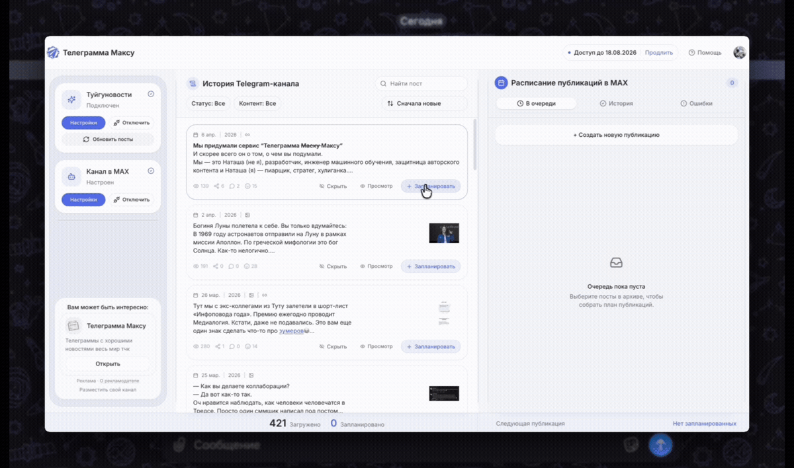
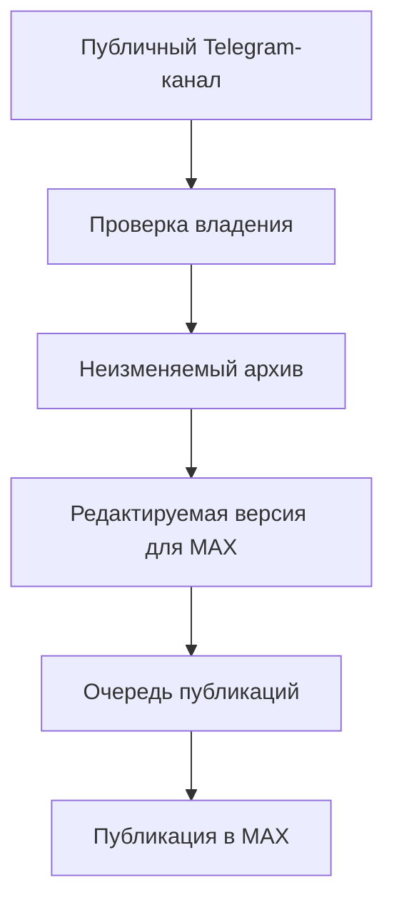
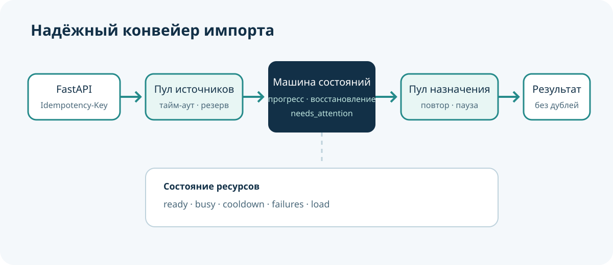

[🇬🇧 English](README.md) | [🇷🇺 Русский](README.ru.md)

# Телеграмма Максу — конвейер переноса контента

«Телеграмма Максу» — сервис для переноса контента из публичных Telegram-каналов в MAX. Он подтверждает владение каналом, собирает публикации в библиотеку, позволяет адаптировать их для новой площадки и формирует управляемую очередь. В этом репозитории представлено инженерное ядро, которое контролирует длительный импорт и позволяет продолжить его после сбоя.

> **Публичный engineering showcase.** Репозиторий выделяет независимо запускаемый модуль надёжности реального коммерческого SaaS. Полный production-сервис также включает веб-приложение, авторизацию, проверку каналов, хранилище медиафайлов, платежи, публикацию, административные инструменты и рабочую инфраструктуру, которые не публикуются.

<p align="center">
  <a href="docs/assets/main-page.gif">
    
  </a>
</p>
<p align="center"><sub>Позиционирование и визуальная система продукта. Нажмите, чтобы открыть в полном размере.</sub></p>

## Продукт

Сервис «Телеграмма Максу» создан для авторов, экспертов и владельцев публичных Telegram-каналов, которые хотят перенести накопленный контент в MAX без повторной подготовки публикаций с нуля.

Пользовательский путь:

1. войти через Yandex ID или VK ID;
2. указать ссылку на публичный Telegram-канал;
3. подтвердить владение через бота проверки или проверочный код в канале;
4. получить предварительный просмотр из пяти публикаций или импортировать доступный архив после оплаты;
5. добавить сервисного бота в MAX-канал и проверить право публикации;
6. выбрать архивный материал или создать новый;
7. отредактировать текст и фотографии;
8. опубликовать сразу или назначить время.

Пользователь не загружает файл архива и не передаёт собственную сессию Telegram. Сервис сам собирает публикации после проверки прав на канал.

Рабочая система включает веб-приложение и BFF на Next.js, серверную часть на FastAPI, PostgreSQL, фоновые обработчики, операторский пул сессий Telegram, S3-совместимое хранилище медиафайлов, модуль публикации в MAX, платежи через T-Bank и российскую инфраструктуру.

<p align="center">
  <a href="docs/assets/dashboard-showcase.gif">
    
  </a>
</p>
<p align="center"><sub>Архив Telegram, редактор публикации и расписание MAX в одном рабочем пространстве. Нажмите, чтобы увеличить.</sub></p>

## Главное продуктовое решение: архив → версия для MAX → очередь

Архив Telegram и очередь публикаций разделены:



Исходная публикация остаётся эталоном, а версия для MAX может получить другой текст, набор изображений и время выхода. Пользователь свободно работает с будущей публикацией, не разрушая импортированный архив.

Система полностью поддерживает текст, ссылки, форматирование, фотографии и фотоальбомы. Медиагруппы Telegram объединяются в одну публикацию, форматированный текст преобразуется в допустимый MAX HTML, а статистика реакций, просмотров, пересылок и комментариев помогает выбирать наиболее сильные материалы.

## Безопасное подключение каналов

- полный импорт доступен только после подтверждения владения Telegram-каналом;
- сервисный бот MAX проходит отдельную проверку права публикации;
- каждый пользователь получает собственное рабочее пространство;
- данные каждого клиента изолированы через `workspace_id` и проверку доступа;
- ключи медиафайлов ограничены рабочим пространством, а файлы выдаются через временные подписанные URL;
- внутренние запросы подписываются HMAC;
- платежи разовые, без автосписаний, через T-Bank.

## Роль и объём работы

Работа над продуктом охватывала весь путь: от пользовательского сценария и интерфейса до импорта, публикации, платежей и рабочей инфраструктуры.

Основные части проекта:

- авторизация через Yandex ID и VK ID и доступ к рабочим пространствам;
- подтверждение владения Telegram-каналом;
- импорт архива и нормализация контента;
- библиотека, редактируемые версии и очередь публикаций;
- пул сессий Telegram и управление фоновыми обработчиками;
- проверка прав бота MAX и процесс публикации;
- S3-совместимое хранилище медиафайлов;
- платежи через T-Bank и управление периодами доступа;
- сайт, юридические и продуктовые страницы, контроль качества и развёртывание.

Отдельной частью работы стала разработка лендинга для пиар-проекта «Трезвые перевозчики в MAX». Это самостоятельная веб-работа, связанная с публичным представлением проекта.

<p align="center">
  <a href="docs/assets/pr-project.png">
    
  </a>
</p>
<p align="center"><sub>Лендинг пиар-проекта «Трезвые перевозчики в MAX».</sub></p>

## Инженерная задача: надёжность импорта

Длительный импорт зависит от ограниченного числа внешних ресурсов, выполняется параллельно и может столкнуться с частичными сбоями. Простого повтора операции здесь недостаточно: система должна учитывать доступную ёмкость, сохранять ход выполнения и не создавать дубли при повторной доставке.



В публичный репозиторий вынесен модуль надёжности, основанный на рабочей системе и пригодный для независимого запуска:

- `ResourcePool` с bounded concurrency, тайм-аутом операции, retry/failover, cooldown и наблюдаемым состоянием ресурсов;
- `ImportJob state machine` с fingerprint входного запроса, SQL-checkpoint, lease и восстановлением после частичной ошибки или перезапуска процесса;
- порт `JobStore`, который отделяет управление импортом от хранения, и два адаптера: быстрый `InMemoryJobStore` и постоянный `SqlAlchemyJobStore`.

## Что демонстрирует код

- ограничение числа параллельных операций для каждого внешнего ресурса;
- последовательное выполнение операций с одним каналом при сохранении параллельности между разными каналами;
- тайм-аут выполнения внешней операции;
- повторы только для временных `TimeoutError` и `ConnectionError`; ошибка данных сразу возвращается вызывающему коду;
- переключение между ресурсами;
- паузу после серии ошибок;
- сводку состояния для API и контроля работы;
- явные состояния `received → fetching → transforming → publishing → completed`;
- отдельное состояние `needs_attention` для передачи оператору;
- контрольную точку после каждого перехода состояния и подтверждённой публикации;
- проверяемый `RecoveryPlan`, который объясняет точку продолжения и отклоняет противоречивое состояние хранилища;
- раннюю проверку уникальности идентификаторов источника до любых публикаций;
- SQL lease, который не позволяет двум экземплярам обработчика одновременно выполнять одну задачу;
- стабильный idempotency token на границе назначения и проверку crash-window при повторной доставке;
- сохранение через SQLAlchemy и восстановление;
- контейнеризованный API-контур FastAPI + PostgreSQL/asyncpg с lifecycle-инициализацией и раздельными liveness/readiness checks;
- воспроизводимую Docker-сборку с зафиксированными runtime-зависимостями и digest базового образа, а также Compose-окружение с ожиданием готовности PostgreSQL;
- тесты конкурентного выполнения на pytest.

## Почему выбраны такие решения

### Пул управляет ёмкостью, а не бизнес-задачей

Сессия, учётная запись или соединение представлены обобщённым ресурсом. `ResourcePool` отвечает за доступность, нагрузку и выбор кандидата, а `ImportService` — за последовательность переноса. Инфраструктурные ошибки и ошибки предметной логики обрабатываются раздельно.

Операции с одинаковым ключом канала сериализуются до занятия общей ёмкости пула. Поэтому две задачи не изменяют один канал одновременно, но ожидание занятого канала не блокирует работу с другими каналами и не расходует доступный слот сессии.

### Пауза после ошибок перераспределяет нагрузку

Ресурс после временных сбоев исключается из выбора на заданный срок. Новые операции переходят на исправного кандидата, а ресурс возвращается автоматически после паузы.

### Ход выполнения фиксируется после подтверждения

`SqlAlchemyJobStore` сохраняет исходные и подготовленные элементы, историю переходов и каждую подтверждённую публикацию. После пересоздания сервиса обработчик продолжает с состояния `fetching`, `transforming` или `publishing`, не повторяя уже выполненную работу.

До сохранения ответа источника предметная модель проверяет уникальность идентификаторов. Перед продолжением она также проверяет согласованность исходных, подготовленных и опубликованных элементов, соответствие receipt его ключу и полноту завершённой задачи. План восстановления содержит точку входа, уже подтверждённые публикации и оставшуюся работу; повреждённая контрольная точка завершается отдельной ошибкой вместо неявного повторения операций.

### Идемпотентность находится на границе назначения

Входной `Idempotency-Key` связывается с SHA-256 fingerprint параметров импорта: повтор с другим источником, назначением или лимитом отклоняется как `409 Conflict`. Для каждого элемента ключ назначения строится из идентификатора задачи и исходного элемента. Даже если процесс остановится после ответа внешнего API, но до SQL-checkpoint, повтор использует тот же token. Единственность внешнего side effect обеспечивается контрактом destination adapter: принимающий сервис должен хранить idempotency token дольше процесса. Regression-тест воспроизводит опасное crash-window и проверяет единственный логический результат через общий ledger.

### Машина состояний упрощает контроль и восстановление

Переходы между состояниями и причина передачи оператору сохраняются в БД. API и обработчик используют одну модель жизненного цикла. Уникальные ограничения защищают `idempotency_key` и пару `job_id + external_id`, foreign key связывает публикацию с задачей, а возобновляемый SQL lease сериализует обработку одного job между экземплярами сервиса.

## С чего начать обзор кода

1. [pool.py](src/reliable_pipeline/pool.py) и [keyed_lock.py](src/reliable_pipeline/keyed_lock.py) — лимиты конкурентности, безопасная при отмене сериализация по ключу, тайм-аут, повтор, переключение ресурсов и пауза после ошибок.
2. [domain.py](src/reliable_pipeline/domain.py) — состояния задачи, инварианты контрольных точек и `RecoveryPlan`.
3. [service.py](src/reliable_pipeline/service.py) — управление импортом и фиксация контрольных точек.
4. [store.py](src/reliable_pipeline/store.py) — порт хранения и SQLAlchemy-адаптер восстановления.
5. [models.py](src/reliable_pipeline/models.py) — постоянная схема задач и публикаций.
6. [adapters.py](src/reliable_pipeline/adapters.py) — интерфейсы источника и назначения.
7. [test_pool.py](tests/test_pool.py) и [test_service.py](tests/test_service.py) — конкурентность, отмена ожидающих задач, классификация повторов и восстановление после перезапуска.
8. [config.py](src/reliable_pipeline/config.py), [Dockerfile](Dockerfile) и [compose.yaml](compose.yaml) — конфигурация и контейнеризованный API-контур с PostgreSQL.

## Минимальный исполняемый сценарий

Требуется Python 3.11+.

```bash
python -m venv .venv
source .venv/bin/activate
pip install -r requirements-dev.lock
pip install --no-build-isolation --no-deps .
reliable-pipeline
```

Команда запускает воспроизводимый сквозной сценарий через локальные адаптеры и выводит состояния задачи, подтверждённые публикации и состояние ресурсов.

HTTP API можно проверить отдельно:

```bash
uvicorn reliable_pipeline.api:app --reload
```

После запуска:

- OpenAPI: `http://127.0.0.1:8000/docs`
- состояние ресурсов: `GET /health/resources`
- создание задачи импорта: `POST /imports`
- состояние задачи: `GET /imports/{job_id}`

Интеграционный сценарий с SQLite проверяет восстановление после перезапуска. Предметная модель, пул ресурсов, постоянные контрольные точки и тесты отказов запускаются без рабочих учётных данных.

### Запуск API с PostgreSQL

```bash
docker compose up --build
curl http://127.0.0.1:8000/health/ready
```

Compose сначала дожидается `pg_isready`, затем запускает API. FastAPI lifespan создаёт SQL-схему и корректно закрывает engine при остановке. `/health/live` проверяет процесс, а `/health/ready` выполняет `SELECT 1` к постоянному хранилищу.

## Тесты и проверки

```bash
ruff format --check .
ruff check .
mypy src tests
bandit -q -r src
pip-audit -r requirements-runtime.lock
pytest
```

`pytest` требует не менее 90% покрытия исполняемого ядра. GitHub Actions проверяет форматирование, стиль, строгую типизацию `src` и `tests`, статический анализ безопасности, известные уязвимости runtime-зависимостей и живую интеграцию с PostgreSQL на Python 3.11 и 3.13. Docker-образ на Python 3.13 собирается отдельным шагом; контейнер устанавливает версии из `requirements-runtime.lock`, а базовые образы Python и PostgreSQL закреплены immutable digest.

## Публичный инженерный контур

Репозиторий сосредоточен на механизмах надёжности для ограниченных ресурсов и длительных задач импорта. Полный сервис дополняет их продуктовым интерфейсом, авторизацией, проверкой каналов, рабочими интеграциями, хранилищем медиафайлов, оплатой и инструментами эксплуатации.

## Автор

**Натали Антро — AI Product Engineer, создатель и единственный разработчик продукта.**
